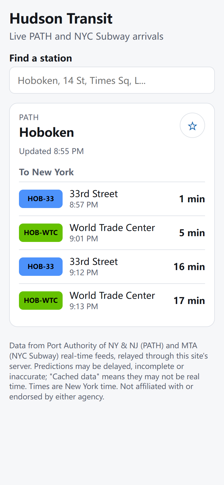
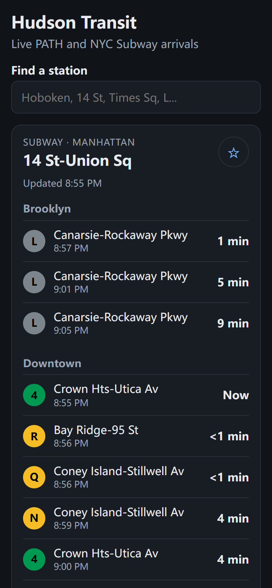

# hudson-transit

[](https://github.com/adleraaa/hudson-transit/actions/workflows/ci.yml)

A live arrivals board for PATH and the NYC Subway, built with Next.js (App Router) and TypeScript. A
Hoboken-to-Manhattan commute usually mixes both systems, but they publish data in unrelated formats:
PATH exposes one JSON document with "seconds to arrival" per station, while the MTA publishes eight
GTFS-realtime protobuf feeds keyed by platform ids like `127N`. This app normalizes both into a single
zod-validated `Arrival` schema on the server, caches it briefly, and renders one mobile-first board with
station search, favorites and auto-refresh. No API keys are needed.

| Light (PATH, Hoboken)                                                                    | Dark (Subway, 14 St-Union Sq)                                                                   |
| ---------------------------------------------------------------------------------------- | ----------------------------------------------------------------------------------------------- |
|  |  |

Screenshots were captured from live data by `scripts/screenshot.ts` on 2026-09-28 around 8:55 PM ET.

## Architecture

```
Browser (client component)                    Next.js server (Node runtime)
+----------------------------+   GET          +-------------------------------------------+
| StationSearch (combobox)   | /api/arrivals/ | route.ts  -> buildBoard(stationId, deps)  |
| favorites (localStorage)   |  path-HOB      |   PATH:   feed cache -> parsePathFeed     |
| useArrivals: poll 30 s     | -------------> |   Subway: 8 feed caches -> subwayArrivals |
|   only while tab visible   | <------------- |   trim: next hour, 3 per route+direction  |
| relative "N min" from now  |  Board (zod)   |   BoardSchema.parse(board) -> JSON        |
+----------------------------+                +-------------------+-----------------------+
                                                                  | fetch, 6 s timeout
                                               createFeedCache: TTL 20 s, coalesced,
                                               stale-if-error up to 5 min, 20 s failure backoff
                                                                  |
                                   panynj.gov ridepath.json   api-endpoint.mta.info (x8 protobuf)
```

- `src/lib/path.ts`, `src/lib/mta.ts`: pure parsers from raw upstream data to `Arrival[]`.
- `src/lib/feed-cache.ts`, `src/lib/feeds.ts`: per-feed TTL cache with request coalescing, stale
  fallback and failure backoff. The PATH shape check runs inside the loader.
- `src/lib/board.ts`: station id to `Board`; dependencies are injected so tests run on fixtures.
- `data/subway-stations.json`: 445 station complexes / 496 stops, generated by `scripts/build-stations.ts`.

## Quickstart

Requires Node 22.12+ (developed on Node 24).

```bash
npm ci
npm run dev            # http://localhost:3000
```

Checks (the same ones CI runs):

```bash
npx eslint . --max-warnings 0
npm run format:check
npm run typecheck
npm test               # vitest, offline
npm run build          # works with no env vars
npx playwright install chromium   # once; locally the config uses installed Chrome instead
npm run test:e2e       # needs the build; API is mocked
```

Reproduce the data and numbers (these hit the live endpoints):

```bash
npm run stations       # regenerate data/subway-stations.json from MTA static GTFS + NY Open Data
npm run fixtures       # re-record tests/fixtures/*
npm run probe          # rewrite results/feed-probe.{json,md}
```

Tests: 78 vitest unit tests (parsers against committed real snapshots, board building with synthetic
feeds, cache, route handler, search, time zones) and 5 Playwright smoke tests against the production
build with a mocked API. These are correctness tests only; there is no load testing or production
traffic data.

## Design decisions

- **Cap trains per route and direction, not per direction.** At a hub, several lines share one
  direction label (the 1/2/3, N/Q/R/W and A/C/E platforms at Times Sq all say "Uptown"). An earlier
  version kept 6 trains per label, so the most frequent lines filled every slot and whole lines
  vanished. The board now keeps the next hour with at most 3 trains per (direction, route). On live
  data the old rule hid at least one route at 24-27 of 445 complexes per probe round (at Times Sq:
  the 3, C, Q or R); the current rule hid none (see [Feed probe](#feed-probe)). A unit test rebuilds
  Times Sq from the A/C/E snapshot plus synthetic 1/2/3 and N/Q/R/W feeds and fails under the old rule.
- **Absolute timestamps in the API, relative labels on the client.** The server returns epoch ms and
  the client computes "in N min" against its own clock every 10 s. A board cached at the CDN or kept
  after a failed refresh therefore still counts down correctly.
- **Explicit time zones.** PATH timestamps carry their UTC offset (`-04:00`) and are parsed with it
  (after trimming microseconds, which ECMAScript does not guarantee to parse); GTFS-rt times are POSIX
  seconds. Clock times are formatted with `timeZone: "America/New_York"`. The unit tests run with
  `TZ=Asia/Tokyo` so code that leans on the machine's zone fails, and they cover the DST fall-back hour.
- **One shared, short-lived cache per feed, with stale-if-error and backoff.** Arrivals are shown in
  whole minutes, so a 20 s TTL costs little accuracy while N concurrent station requests share one
  upstream call. If a refresh fails (network error, timeout, non-200, or a PATH body with the wrong
  shape), data up to 5 minutes old is served and flagged `stale`, and the next retry waits 20 s so a
  hung upstream does not make every request wait for the 6 s timeout. Past 5 minutes that feed
  counts as unavailable, because old predictions mislead.
- **Say what is missing instead of showing an empty board.** Each station's routes map to the feeds
  that carry them. If one of those feeds is down, the board lists the affected routes in a visible
  note (`unavailableRoutes`), and if all of them are down the API returns 503. For the subway,
  `dataAsOf` is the feed's own header timestamp, and a header more than 2 minutes old marks the board
  stale; in the probe, MTA headers were 0-12 s old at fetch time.
- **Query every MTA feed for every station.** Station data only lists daytime routes, and at night other
  lines run local (for example the D along 4 Av, which is in a different feed than the R). Since each
  feed is cached and shared, this is cheap: matching all 445 complexes against all eight decoded feeds
  took 102-239 ms of wall time per probe round.
- **Server-side relay only.** Browsers never call PATH or MTA directly: the MTA data terms ask apps to
  serve data from their own servers, and it also avoids CORS and keeps the client payload small.

## Feed probe

Measured by `npm run probe` (3 rounds, 20 s apart, 2026-09-29 00:53-00:54 UTC, i9-14900HX laptop on a
home connection in Hoboken, Node 24). Full output, including per-feed fetch times:
[`results/feed-probe.md`](results/feed-probe.md) / [`results/feed-probe.json`](results/feed-probe.json).

- Station coverage: in all 3 rounds, 13/13 PATH stations and 445/445 subway complexes had at least one
  predicted train that the parsers could attach to a named station.
- About 0.7% of stop references in the MTA feeds (97-98 of ~13,800 per round) use ids that are not in
  the static GTFS (for example `H19N`, `R60S`); they look like non-revenue timing points. The parser skips
  them and never shows them as a destination (covered by a unit test).
- One round of all nine feeds is about 574 KiB (1-7/S alone is 179 KiB), which is why the server fetches
  each feed once per TTL and shares it across stations instead of fetching per request.
- Data age at fetch time: MTA feed headers were 0-12 s old. PATH has no feed-level timestamp; the newest
  per-prediction `lastUpdated` was 36-70 s old, and quiet stations can be older, so PATH boards use
  the server's fetch time as `dataAsOf` and are not checked for freezing.
- Cap check: see the first design decision.

## Limitations

- The cache is in-process memory, so on Vercel each serverless instance has its own copy and a cold
  instance must fetch before it can serve stale data. A shared store (for example Redis) would fix
  this; it is not implemented.
- Worst-case staleness adds up: the route sends `Cache-Control: s-maxage=15, stale-while-revalidate=15`,
  the server TTL is 20 s and the client polls every 30 s, so a prediction can be over a minute old
  when it reaches the screen (upstream delay not included).
- A frozen PATH feed is not detected (see above); only MTA feeds are checked.
- Relative times use the device clock. A phone whose clock is off by a minute shows countdowns off by a
  minute. Correcting it from the response is unreliable here because CDN-cached responses carry an
  older `generatedAt`.
- At the largest hubs the board is long (Times Sq can show about 30 trains per direction, 3 for each of
  about 10 routes). Grouping rows by line would read better; it is not implemented.
- No MTA service alerts, elevator status or PATH advisories; only arrival predictions.
- Trains that terminate at the selected station are hidden (you cannot board them). Destinations use
  the last stop the feed lists, which during reroutes can differ from the train's signed destination.
- PATH line names are derived from the four published line colors; an unknown color shows as "PATH".
- Not yet deployed. The app builds with no environment variables and is intended for Vercel; the
  Vercel import is pending.

## Data sources and terms

- PATH real-time: `https://www.panynj.gov/bin/portauthority/ridepath.json` (Port Authority of NY & NJ).
  No license or developer terms were found for this endpoint (the site footer reads "All Rights
  Reserved"). The repo includes one 9.4 KiB snapshot (9,586 bytes of train predictions) as a test
  fixture only, and `npm run fixtures` re-records it; it will be removed on request.
- MTA subway GTFS-realtime feeds: `https://api-endpoint.mta.info/Dataservice/mtagtfsfeeds/nyct%2Fgtfs`
  (and `-ace`, `-bdfm`, `-g`, `-jz`, `-nqrw`, `-l`, `-si`), used under the MTA data feed terms
  (https://www.mta.info/developers/terms-and-conditions). Three small snapshots are committed as fixtures.
- MTA static subway GTFS: https://rrgtfsfeeds.s3.amazonaws.com/gtfs_subway.zip (same MTA terms).
- MTA Subway Stations on NY Open Data: https://data.ny.gov/d/39hk-dx4f (NY Open Data terms of use).

This project is not affiliated with or endorsed by the MTA or the Port Authority, and makes no claim
that the data is accurate, complete or timely. Subway route names, colors and bullet designs are MTA
trademarks and PATH line names belong to the Port Authority; they are used only to identify the
services.

## License

MIT, copyright 2026 Yunlong (Adler) Lu. See [LICENSE](LICENSE). Data remains subject to the terms above.
